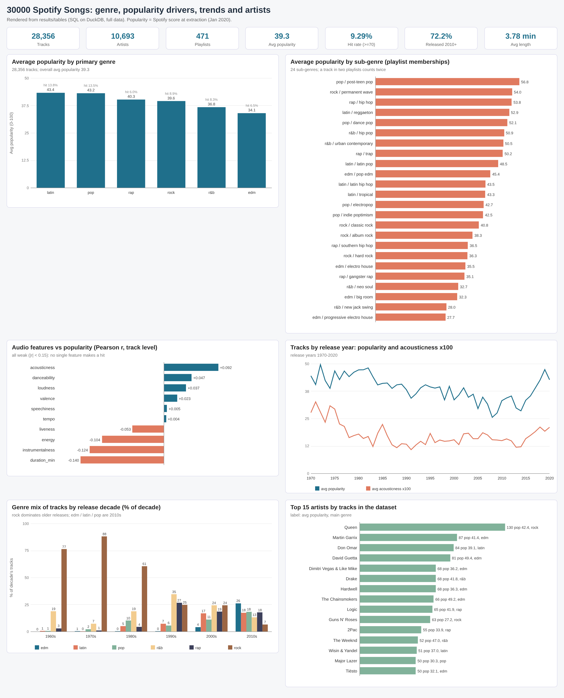
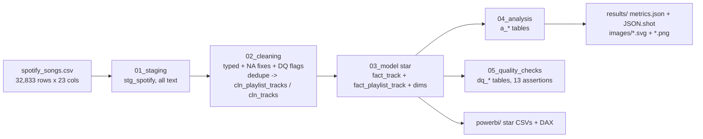
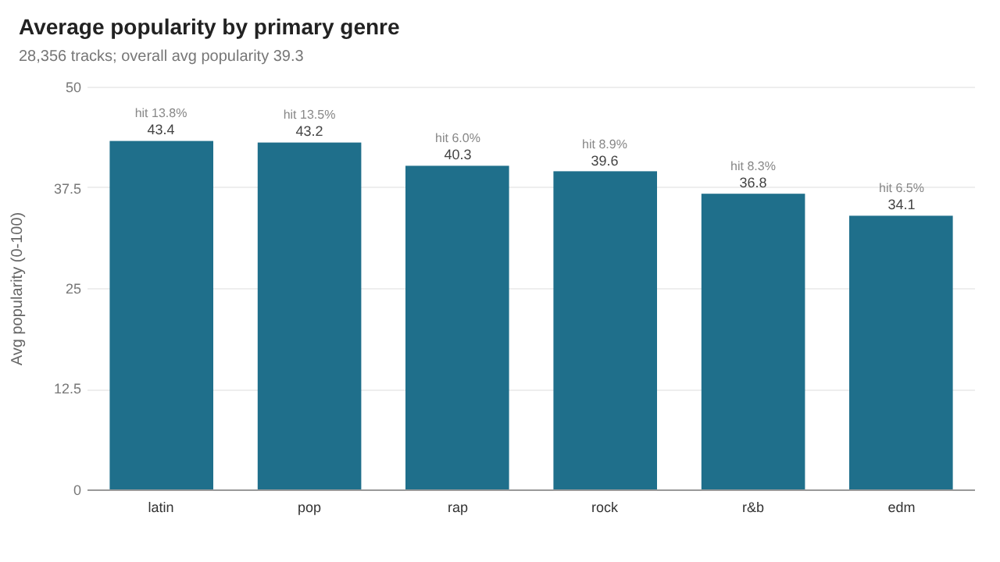
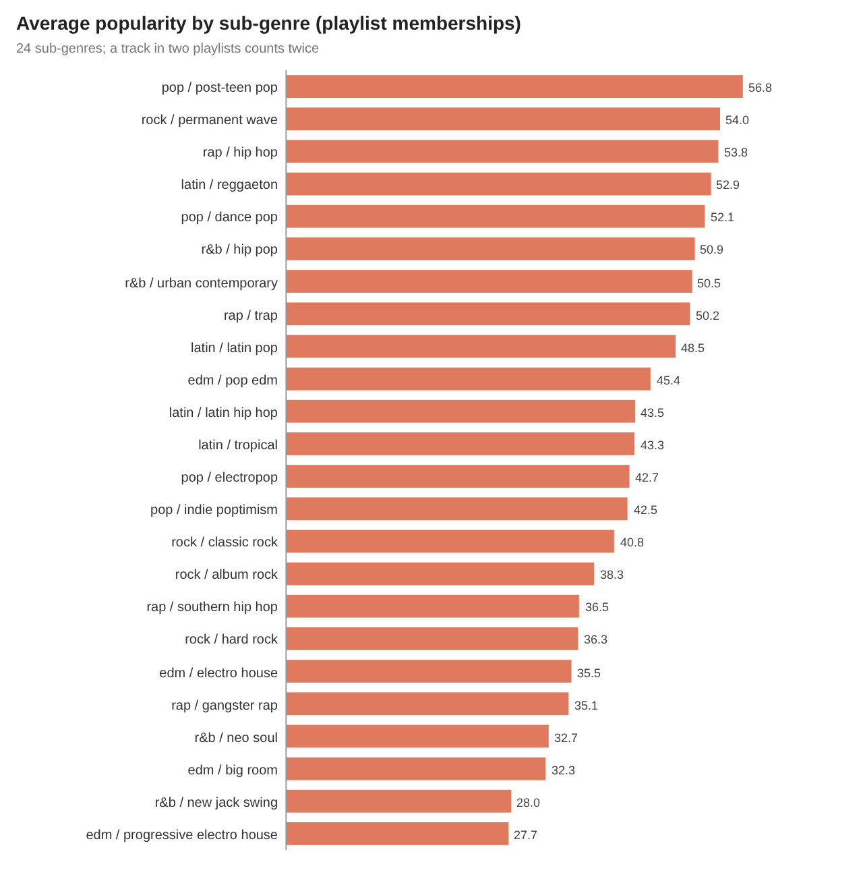
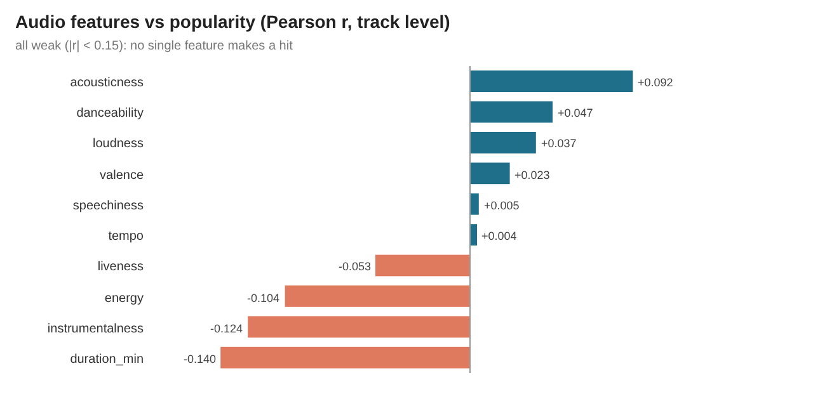
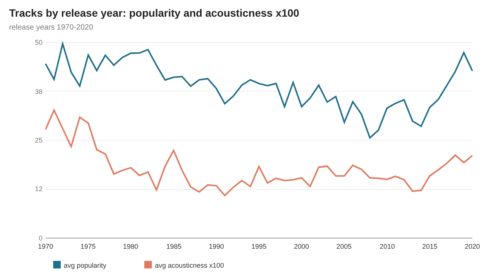
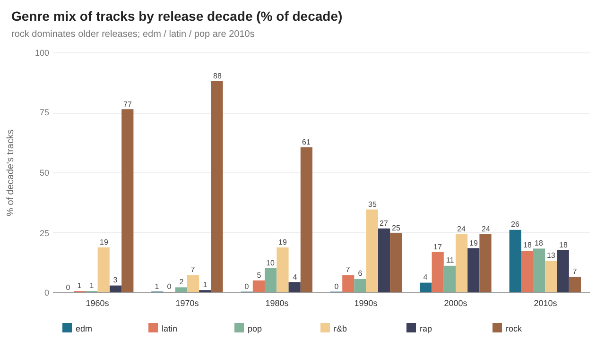
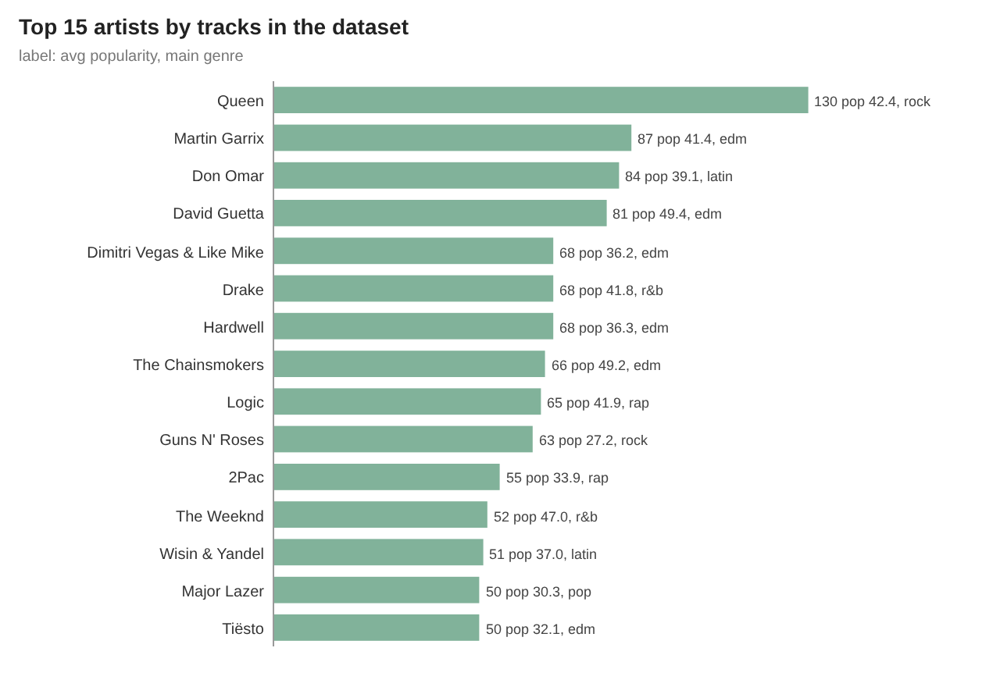
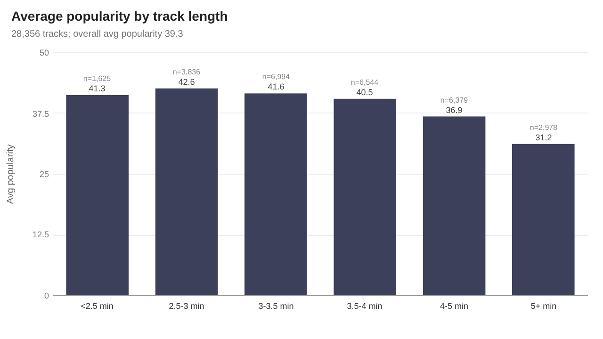

# da-learn-09 · Spotify music trends (30000 Spotify Songs)

A data-analyst learning project. It analyses the **TidyTuesday / Kaggle "30000 Spotify Songs" file (32,833 raw playlist rows → 28,356 unique tracks)**, collected with the `spotifyr` R package from the Spotify Web API (snapshot Jan 2020). The raw CSV goes through SQL staging, cleaning (type fixes, NA handling, dedupe, primary-genre assignment), a star schema, analysis and quality checks. DuckDB runs the whole pipeline locally on the **full** file. The outputs are a Power BI kit plus SVG and PNG charts in `results/images/`.

> **Databricks was skipped** for this project because the Databricks workspace hit its resource quota. There is no live Lakeview dashboard; the SQL stays Databricks/Spark-compatible (DuckDB shims are isolated in `sql/00`), and all charts and KPIs are in [`results/`](results/RESULTS.md).



## Business questions
1. How big is the catalogue (tracks, artists, playlists), and what is the overall popularity / hit rate?
2. Which primary genres and sub-genres are most popular, and how do their audio profiles differ?
3. Do any Spotify audio features (danceability, energy, acousticness, …) correlate with popularity?
4. How have genre mix, popularity and acousticness changed by release year / decade?
5. Which artists appear most often, and who has the highest average popularity (min 10 tracks)?
6. How clean is the raw file (duplicate playlist rows, missing metadata, duration outliers, zero-tempo)?

## Pipeline


## Headline insights (full data, 28,356 unique tracks)
- **Catalogue:** 28,356 unique tracks across 10,693 artists, 22,545 albums and 471 playlists (32,251 playlist memberships after dropping 582 duplicate `(track_id, playlist_id)` rows from 32,833 raw). Average popularity is **39.33**; **9.29%** are hits (popularity ≥ 70) and 9.24% have popularity 0. **72.15%** of tracks were released in 2010 or later; average length is 3.776 min.
- **Genres:** EDM has the most tracks (5,537, 19.53%) but the lowest average popularity (34.07). **Latin** (43.35) and **pop** (43.16) lead on popularity and hit rate (13.82% / 13.46%). At sub-genre grain, **pop / post-teen pop** averages 56.83 popularity (40.12% hits); edm / progressive electro house is last at 27.71.
- **Audio features:** every Pearson correlation with popularity is weak (`|r| < 0.15`). The strongest negative links are duration (−0.140) and instrumentalness (−0.124); the strongest positive is acousticness (+0.092). Tracks of 2.5–3 min average 42.65 popularity vs 31.22 for 5+ min tracks.
- **Decades:** rock was **88.25%** of 1970s tracks and only **6.65%** of 2010s tracks; EDM is **26.22%** of the 2010s. Average popularity dips in the 2000s (31.93) and recovers in the 2010s (40.38). Tracks get shorter over time (4.47 min in the 1980s → 3.60 in the 2010s).
- **Artists:** Queen has the most tracks in the file (130, avg pop 42.4, rock); among artists with ≥ 10 tracks, **Billie Eilish** leads on average popularity (76.96 across 26 tracks). The top 10 artists by hit count hold only 6.64% of all hits.
- **Data quality:** 582 duplicate playlist rows removed (32,833 → 32,251). 1,533 tracks appear under more than one genre (a primary genre is assigned). 2,620 popularity-0 tracks, 1,656 year-only release dates and 191 duration outliers are kept and flagged. All **13 / 13** assertions pass.

## Charts
All charts are in `results/images/` as SVG (plain vector shapes) and PNG (2x render of the same SVG).

| | |
|---|---|
|  |  |
|  |  |
|  |  |
|  | |

## How to run
```bash
pip install -r requirements.txt
python run_pipeline.py --source sample       # committed 135-row sample in data/raw/, results in results/sample/
python scripts/download_full_data.py         # ~8.0 MB into data/raw_full/ (SHA-256 checked)
python run_pipeline.py --source full         # full catalogue: results/, data/clean/, powerbi/data/
python scripts/render_png.py                 # results/images/*.svg -> *.png with headless Chrome
```
`scripts/make_sample.py` rebuilds the committed sample from the full file.

## Repo layout
```
data/raw/            135-row raw sample (all 6 genres + edge cases); full file via scripts/download_full_data.py
data/clean/          cleaned CSVs + star (produced by --source full; gitignored — regenerate locally)
sql/                 00 DuckDB shims, 01 staging, 02 cleaning, 03 star model, 04 analysis, 05 quality checks
run_pipeline.py      DuckDB runner (sample | full)
scripts/             project config, sample builder, downloader, SVG chart writer, PNG renderer
results/             RESULTS.md, metrics.json, JSON.shot, tables/*.csv, images/*.svg + *.png (dashboard = overview)
powerbi/             full star CSVs (~8 MB), measures.dax, model.md, dashboard_spec.md, BUILD_GUIDE.md
```

## Caveats
- Popularity is Spotify's 0–100 score **at extraction (Jan 2020)**, not streams or lasting fame. Zero-popularity tracks (9.24%) skew some averages; `corr_nonzero` in the feature table excludes them.
- Genre and sub-genre come from the **playlist** the track was scraped from, not from Spotify's track taxonomy. 1,533 tracks appear under more than one genre; `primary_genre` is the genre of the most playlist rows (ties alphabetical).
- A track can sit on several playlists (32,251 memberships for 28,356 tracks). Sub-genre charts use membership grain; everything else is track grain.
- Release dates are often year-only (1,656) or year-month (25); they are padded to the 1st and the precision is kept. 2020 is a partial year.
- The file is a playlist scrape, not a random sample of Spotify, so artist and genre shares reflect playlist curation (EDM and rap playlists are over-represented relative to the whole catalogue).

## Complete dataset
- **Kaggle page:** https://www.kaggle.com/datasets/joebeachcapital/30000-spotify-songs ("30000 Spotify Songs" by Joe Beach Capital; TidyTuesday 2020-01-21 mirror)
- **Mirror used (exact URL):** https://raw.githubusercontent.com/rfordatascience/tidytuesday/master/data/2020/2020-01-21/spotify_songs.csv (SHA-256 `9902920cfe4940f0914ebb6716801a42f7f19ac88fbd6693eaae7e2822b16845`)
- **Licence:** TidyTuesday repository CC0 1.0; Kaggle mirror lists Open Database License (ODbL). Underlying data © Spotify, provided through the Spotify Web API — use for learning / non-commercial analysis.
- **Total size:** 7,971,379 bytes (~7.97 MB)
- **Files:** `spotify_songs.csv` only: 32,833 rows × 23 columns (`track_id, track_name, track_artist, track_popularity, track_album_id, track_album_name, track_album_release_date, playlist_name, playlist_id, playlist_genre, playlist_subgenre, danceability, energy, key, loudness, mode, speechiness, acousticness, instrumentalness, liveness, valence, tempo, duration_ms`)
- **Download:** `python scripts/download_full_data.py` (writes to data/raw_full/ and verifies SHA-256)
