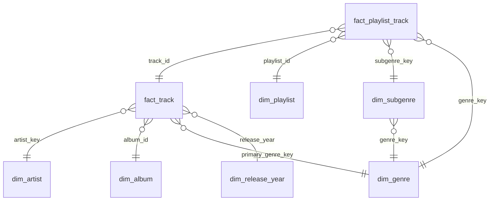

# Power BI model - da-learn-09 Spotify music trends

Import every CSV in `powerbi/data/` (full data, 28,356 tracks / 32,251 playlist memberships; built by `python run_pipeline.py --source full`). Total size of the star CSVs is ~8 MB.

| Table | Grain | Key | Notes |
|---|---|---|---|
| fact_track | one track | track_id | popularity, hit_flag, audio features, duration, primary genre, playlist_count, DQ flags |
| fact_playlist_track | track × playlist | track_id, playlist_id | genre_key / subgenre_key of that playlist membership |
| dim_artist | artist | artist_key | 10,693 artists |
| dim_album | album | album_id | 22,545 albums; release_date + precision |
| dim_genre | primary / playlist genre | genre_key | 6 genres (edm, latin, pop, r&b, rap, rock) |
| dim_subgenre | genre × subgenre | subgenre_key | 24 sub-genres; also carries genre_key |
| dim_playlist | playlist | playlist_id | 471 playlists; `tracks` = membership count |
| dim_release_year | release year | release_year | 63 years; decade + era |

## Relationships
- `fact_track[artist_key]` → `dim_artist[artist_key]` (many-to-one)
- `fact_track[album_id]` → `dim_album[album_id]` (many-to-one)
- `fact_track[primary_genre_key]` → `dim_genre[genre_key]` (many-to-one)
- `fact_track[release_year]` → `dim_release_year[release_year]` (many-to-one)
- `fact_playlist_track[track_id]` → `fact_track[track_id]` (many-to-one, **both** directions so a playlist / sub-genre slicer filters tracks)
- `fact_playlist_track[playlist_id]` → `dim_playlist[playlist_id]` (many-to-one)
- `fact_playlist_track[subgenre_key]` → `dim_subgenre[subgenre_key]` (many-to-one)
- `fact_playlist_track[genre_key]` → `dim_genre[genre_key]` (many-to-one) — optional; primary-genre analysis should use `fact_track[primary_genre_key]` instead so a track is not double-counted
- Sort `fact_track[popularity_band]` and `fact_track[duration_band]` by the columns themselves (they carry a numeric / letter prefix).
